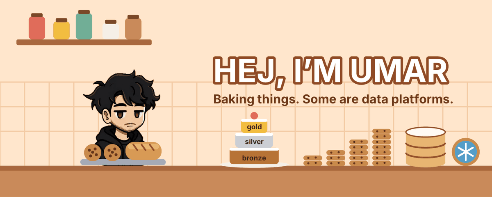

  

Fresh out of the oven.

  <a href="https://github.com/Kronus4k/slussen"><b>Slussen</b></a>
  &nbsp;·&nbsp;
  <a href="https://github.com/Kronus4k/battery-revenue-optimizer"><b>Battery Revenue Optimizer</b></a>

- Building [Slussen](https://github.com/Kronus4k/slussen), a data platform named after Stockholm’s lock, because only valid data gets through.
- Curious about the Swedish power market, so I [backtested](https://github.com/Kronus4k/battery-revenue-optimizer) whether a battery should trade or stand by for the grid.
- Learning Swedish (A2, working on B1) and studying for the AWS Solutions Architect exam.
- Off-screen: tennis 🎾, swimming 🏊 and half marathons.
- At home: I bake cookies and breads, love aquariums and aquascaping, and game casually.
